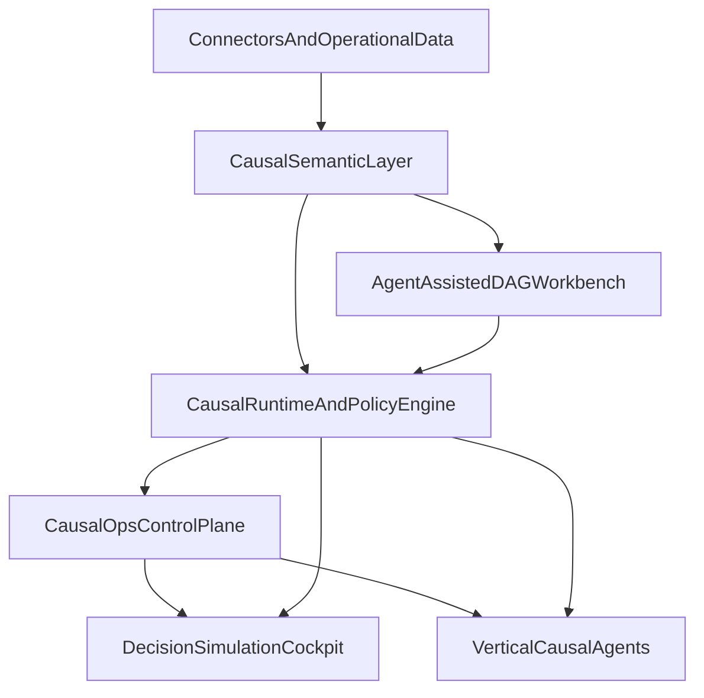
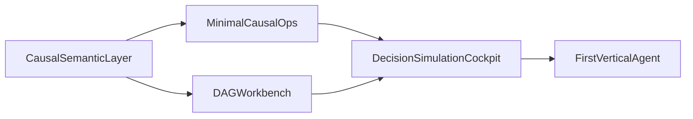

# Unified Enterprise Causal Platform

## Category Statement

The company should be positioned as an **enterprise causal operating system**: a governed platform that helps organizations model causal knowledge once, validate it continuously, simulate decisions safely, and operationalize recommendations inside domain workflows.

This is not just a causal modeling tool, BI add-on, or agent framework. It is a full-stack decision platform that combines:

- a shared causal semantic layer
- human-in-the-loop graph construction
- causal validation and governance
- decision-facing simulation interfaces
- workflow-native vertical agents

## Platform Thesis

The five original ideas are best treated as product layers on top of one shared runtime rather than as separate products:

- `Causal Semantic Layer` is the system of record
- `Agent-Assisted DAG Workbench` is the knowledge-building surface
- `CausalOps Platform` is the trust and operations control plane
- `Decision Simulation Cockpit` is the horizontal decisioning interface
- `Vertical Causal Agents` are the domain entry points

This creates a single platform with reusable assets instead of five disconnected SKUs.

## Layer Model

## Platform Layers

### 1. Foundation: Causal Semantic Layer

This layer should manage reusable business-level causal objects:

- entities such as customer, incident, service, supplier, campaign, or account
- treatments, outcomes, mediators, and confounders
- interventions and action types
- graph fragments and approved edges
- time windows and event definitions
- evidence, assumptions, and lineage

Its job is to turn causal reasoning into a governed enterprise asset instead of a notebook artifact.

### 2. Knowledge Layer: Agent-Assisted DAG Workbench

This module should help domain experts and analysts co-build causal structure faster.

Core responsibilities:

- propose candidate edges and missing variables
- surface contradictory assumptions
- ground graph suggestions in documents, metrics, and prior graph assets
- require human approval before graph changes become active
- version causal models and supporting rationale

The workbench should write approved structure back into the semantic layer so the rest of the platform can reuse it.

### 3. Trust Layer: CausalOps Control Plane

This is the control plane for production-grade causal decisioning.

It should manage:

- assumption review workflows
- sensitivity and robustness testing
- placebo and negative-control checks
- causal drift monitoring
- semantic drift monitoring
- audit trails and approval gates
- policy enforcement for high-stakes decisions

Without this layer, the platform becomes hard to trust outside research teams.

### 4. Decision Layer: Decision Simulation Cockpit

This is the horizontal interface for business users who need answers to decision questions rather than modeling outputs.

It should expose:

- what-if analysis
- counterfactual comparison
- action ranking under budget constraints
- scenario ranges and confidence boundaries
- narrative explanations tied to explicit causal assumptions

The cockpit is what makes the platform usable beyond expert modelers.

### 5. Workflow Layer: Vertical Causal Agents

These are packaged applications for specific operational domains. They should not invent their own data model or governance logic. Instead, they should consume the same semantic objects, runtime services, and control policies as the rest of the platform.

Initial verticals that fit the platform well:

- DevOps incident and change management
- marketing spend allocation
- supply chain disruption response
- customer success churn prevention

## Core Product Architecture

The cleanest commercial structure is:

- one core platform: semantic layer, runtime, policy engine, and governance
- one builder product: agent-assisted DAG workbench
- one horizontal consumer product: decision simulation cockpit
- multiple vertical solution packs: domain agents and templates

This keeps the company architecture coherent while preserving modular packaging.

## Product Roadmap

### Phase 1: Shared Data And Trust Foundation

Build the smallest platform that can support all later surfaces.

Deliver:

- causal semantic object model
- graph and assumption registry
- intervention and event logging model
- evidence and lineage capture
- minimal approval workflow
- initial validation harness for sensitivity and placebo testing

Exit criteria:

- teams can create a reusable causal asset without notebooks as the source of truth
- every approved graph object has lineage, ownership, and review metadata

### Phase 2: DAG Workbench

Add the builder surface that helps teams populate the platform.

Deliver:

- graph authoring UI
- agent suggestions for edges, confounders, and missing data
- document-grounded evidence linking
- human approval and versioning workflow
- reusable graph fragments by domain

Exit criteria:

- subject-matter experts can contribute causal structure without writing code
- approved graph assets can be promoted into governed use

### Phase 3: First Decision Simulation Surface

Launch a single high-value simulation experience for one narrow use case.

Deliver:

- intervention comparison UI
- outcome simulation with constraints
- recommendation summaries with explicit assumptions
- audit-ready output and review logs

Exit criteria:

- one operational team can use the platform to compare actions before execution
- simulation output is tied to approved causal assets and governance checks

### Phase 4: First Vertical Agent

Package the platform into a workflow-native application.

Deliver:

- domain-specific connectors
- domain ontology templates
- workflow playbooks and recommended interventions
- approval gates and feedback loops from actual outcomes

Exit criteria:

- the product solves one recurring operational workflow end to end
- users see measurable value in reduced time-to-decision or better intervention quality

### Phase 5: Multi-Vertical Expansion

After proving one wedge, expand using the same primitives rather than rebuilding.

Deliver:

- reusable vertical agent framework
- template packs for additional domains
- shared metrics and policy libraries
- expanded connector coverage

Exit criteria:

- new verticals reuse the same semantic model, governance rules, and runtime engine
- expansion cost is low because the core platform does most of the work

## Dependency Logic

The roadmap should follow this dependency order:

The reason for this order is simple:

- without semantics, causal assets do not compose
- without governance, enterprise adoption stalls
- without a workbench, asset creation is too expert-heavy
- without a decision surface, value stays invisible
- without a vertical wedge, go-to-market stays too abstract

## Recommended First Entry Point

The best initial wedge is **DevOps incident and change management**, delivered as a vertical causal agent on top of the shared platform.

### Why DevOps First

- there is strong technical precedent in the DevOps domain from prior research
- incidents, rollbacks, deployments, alerts, and service changes are naturally intervention-rich
- outcome signals are frequent enough to learn quickly
- the workflow is operational, repeated, and economically visible
- teams already live in systems with strong logging and event trails
- the problem space is narrow enough to constrain ontology drift

### Why Not Start With A Pure Horizontal Product

A horizontal cockpit or semantic layer alone is strategically important, but it is harder to sell first because buyers often need a direct workflow outcome before they pay for platform infrastructure.

DevOps gives the company:

- a bounded ontology
- clearer ROI
- faster feedback loops
- a tractable integration set
- an easier story for approvals, audit, and recommendation review

### DevOps Wedge Scope

The first version should focus on a specific decision loop:

- change introduced
- anomaly or incident appears
- platform proposes likely causal drivers and next interventions
- operator simulates rollback, mitigation, or traffic-routing actions
- action is approved through policy gates
- actual outcome is logged back into the platform

### Initial User Roles

- platform engineer
- site reliability engineer
- incident commander
- engineering manager

### First Success Metrics

- time to identify plausible root causes
- time to approved mitigation
- rollback accuracy or avoidance of unnecessary rollback
- incident resolution quality
- confidence and auditability of operational decisions

## Packaging Recommendation

Use modular packaging instead of independent products:

- `Core Platform`
- `Workbench`
- `Simulation`
- `DevOps Agent`

This lets the company land with a vertical solution while expanding into a broader causal platform over time.

## Bottom Line

The right company shape is one platform with several surfaces, not five standalone products. The right launch motion is to build the semantic and governance core first, prove value with a DevOps vertical agent, and then expand into broader decision simulation and additional operational domains.
